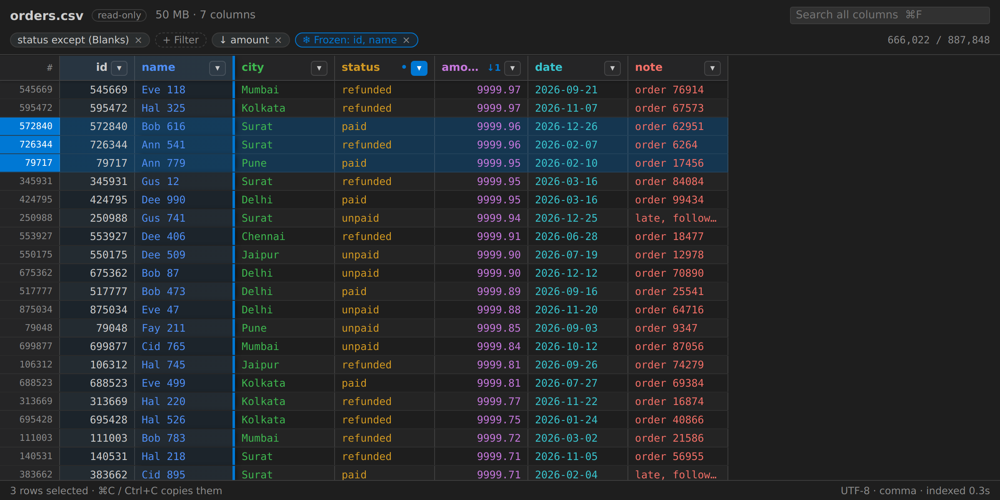
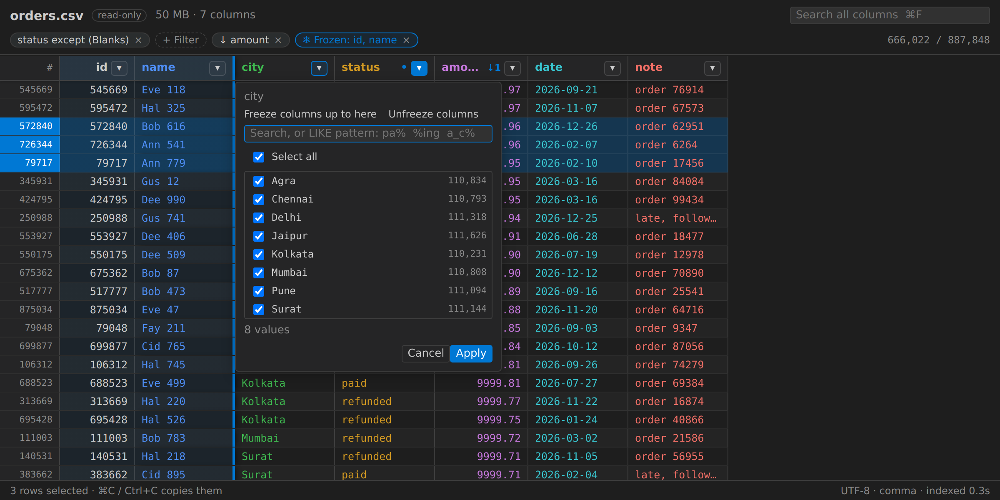
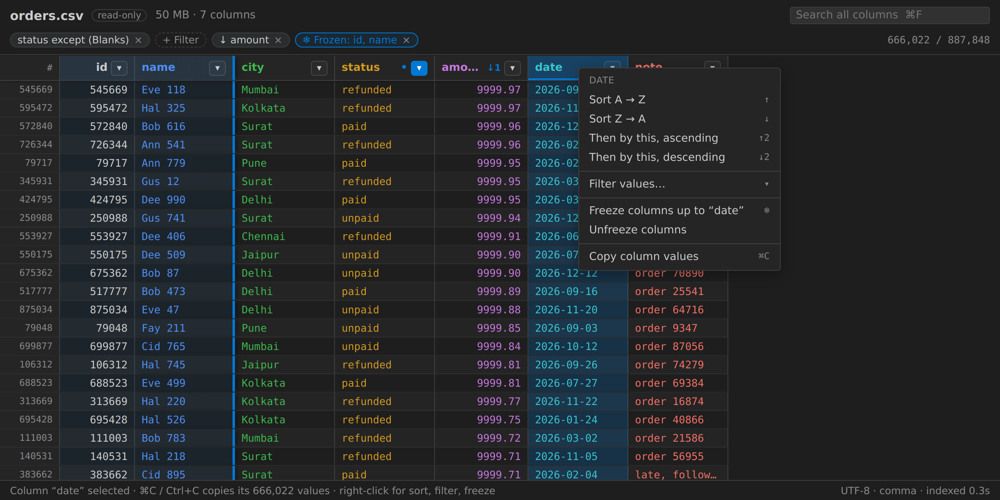

# OCVYN — Only CSV Viewer You Need

Open big CSV, TSV and spreadsheet files in VS Code as a fast, read-only grid.
Filter like a spreadsheet, sort by several columns, freeze columns, and copy what you need.
Everything runs locally. Nothing is uploaded, and your file is never changed.

> **Beta.** OCVYN is still in beta. It is provided "as is", without warranty of any kind. Use it at your own risk. See [Disclaimer](#disclaimer).



## Features

- **Handles big files.** CSV and TSV up to 500 MB. The first rows show in well under a second and the rest loads in the background, so VS Code never freezes. Only the rows on screen are drawn.
- **Spreadsheet-style column filters.** Click ▾ on any column to see every distinct value with its count. Search the list, tick or untick values, or select all.
- **LIKE search.** In the filter search box, plain text matches values that contain it. Use `%` for a pattern: `pa%` (starts with), `%ing` (ends with), `p_ne%` (`_` is one character).
- **Filter rules.** `+ Filter` builds rules such as *amount > 500* or *status is not paid*, combined with *all* or *any*. A search box (`Ctrl+F` / `⌘F`) matches any column.
- **Multi-level sort.** Right-click a column → sort, then *Then by this* to add more levels. Numbers sort as numbers; blanks always go last.
- **Freeze columns.** Right-click → *Freeze columns up to here*. Frozen columns stay put while you scroll sideways.
- **Select and copy.** Click a cell, a row number (Shift for a range, Ctrl/⌘ to add) or a column header. `Ctrl+C` / `⌘C` copies cells, rows or a whole column as tab-separated text that pastes straight into a spreadsheet.
- **Easy on the eyes.** Colour-coded columns, striped rows and clear grid lines, all taken from your VS Code theme (light or dark).
- **Excel files too.** `.xlsx` and `.xls` up to 50 MB, with a sheet picker.





## How to use

CSV, TSV, XLSX and XLS files open in OCVYN automatically.

- **See the plain text instead:** right-click the tab → *Reopen Editor With…* → *Text Editor*.
- **Back to the grid:** click the table button at the top right of the editor, or run **Open in OCVYN** from the Command Palette.

| Action | How |
|---|---|
| Filter a column by value | ▾ on the column header |
| Sort, freeze, copy a column | Right-click a header or cell |
| Search all columns | `Ctrl+F` / `⌘F` |
| Select rows | Click row numbers (Shift = range, Ctrl/⌘ = add) |
| Select a column | Click its header |
| Copy | `Ctrl+C` / `⌘C` |
| Clear selection | `Esc` |
| Resize a column | Drag the header's right edge |

## Limits

- Read-only: there is no editing or saving.
- CSV/TSV files up to 500 MB; Excel files up to 50 MB.
- Files are read as UTF-8.
- The view is a snapshot. If the file changes on disk, close and reopen it.
- A column's value list shows up to 500,000 distinct values. Filters and LIKE still check every row.
- Copying is limited to 100,000 rows at a time.

## Privacy

OCVYN collects no data, has no telemetry and makes no network requests. See [PRIVACY.md](PRIVACY.md).

## Credits

Reads Excel files with [SheetJS Community Edition](https://sheetjs.com/) (Apache-2.0). See [THIRD_PARTY_NOTICES.md](THIRD_PARTY_NOTICES.md).

## Disclaimer

OCVYN is beta software, provided "as is", without warranty of any kind, express or implied. You use it at your own risk. The author is not liable for any claim, damage or loss arising from its use, including incorrect display, filtering, sorting or copying of data. Always check important results against the original file.

By installing or using OCVYN you agree to the terms of its [MIT License](LICENSE) and to this disclaimer, and acknowledge the [privacy notice](PRIVACY.md).

## License

[MIT](LICENSE)

## Building from source

```sh
npm install
npm test
npm run package     # → ocvyn-<version>.vsix
```
